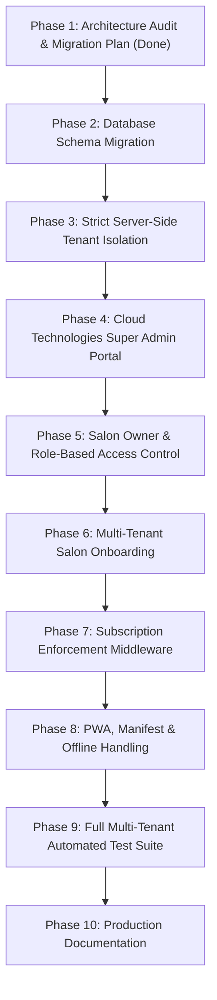

# CLOUD SALON — Multi-Tenant SaaS Implementation Plan
**Document:** Multi-Tenancy Implementation Roadmap  
**Author:** Principal SaaS Architect & Full-Stack Engineer  
**Date:** November 15, 2026  
**Product:** Cloud Salon by Cloud Technologies  
**Target URL:** https://salon.cloudtechnologiess.in  

---

## 1. Multi-Tenancy Architectural Principles

Cloud Salon serves multiple independent salon businesses across India from **ONE central deployment and codebase**. To achieve commercial reliability without data leakage or performance degradation, the system enforces the following non-negotiable rules:

1. **Single Central Application & URL**: The platform runs centrally at `https://salon.cloudtechnologiess.in`.
2. **Server-Side Trusted Tenant Resolution**:
   - The salon context is resolved **strictly from the authenticated user's JWT access token**.
   - Client-side headers (`X-Tenant-ID`) or query parameters are **never trusted** for data isolation.
3. **Cross-Tenant Isolation Firewalls**:
   - Every read, create, update, and delete operation on salon entities (`customers`, `appointments`, `invoices`, `services`, `staff`, `products`, `expenses`) mandates a matching `tenant_id`.
   - Accessing another salon's record ID returns `HTTP 404 Not Found` or `HTTP 403 Forbidden`.
4. **Subscription Lifecycle Governance**:
   - Every operational endpoint validates the salon's subscription state (`TRIAL`, `ACTIVE`, `PAYMENT_PENDING`, `EXPIRED`, `SUSPENDED`).
   - Suspended or expired salons are restricted from business operations with clear renewal prompts.
5. **Super Admin Privacy Guard**:
   - Cloud Technologies platform administrators (`SUPER_ADMIN`) manage salons, subscriptions, plans, and platform health.
   - **Super Admins are strictly blocked by backend security policies from viewing private salon operational records** (customer contacts, individual bills, stylist salaries, commissions).
6. **Progressive Web App (PWA)**:
   - Installable on desktop, Android, and tablets with offline informational fallback.

---

## 2. Phase-by-Phase Execution Roadmap

### Detailed Deliverables by Phase:

### Phase 2 — Database Schema & Models
* Define `SubscriptionPlan`, `Subscription`, and `PlatformAuditLog` ORM models.
* Enhance `Tenant` model with `owner_name`, `business_type`, `subscription_plan_id`, `subscription_status`, `subscription_start_date`, `subscription_end_date`, `timezone`, `tax_configuration`.
* Update `User` model to allow `tenant_id = None` for `SUPER_ADMIN`.
* Add scoped uniqueness constraints on PostgreSQL.
* Apply Alembic migration.

### Phase 3 — Strict Tenant Resolution & Security Firewalls
* Rewrite `backend/app/core/deps.py`:
  - `get_current_user`: extracts `user_id` and `tenant_id` from trusted JWT claims.
  - `get_current_salon`: queries and returns the authenticated user's salon object.
  - `require_active_subscription`: verifies the salon is `ACTIVE` or `TRIAL`.
  - `require_super_admin`: verifies `role == "SUPER_ADMIN"`.
* Audit all API routers (`appointments.py`, `pos.py`, `customers.py`, `inventory.py`, `expenses.py`, `reports.py`) to eliminate reliance on client-supplied headers.

### Phase 4 — Cloud Technologies Super Admin
* Backend API (`/api/v1/super-admin`):
  - `GET /metrics`: Total salons, active, trials, expired, MRR, platform audit trail.
  - `GET /salons`: List of registered salons with technical metadata and subscription status.
  - `POST /salons`: Register a new salon tenant and provision owner account.
  - `PUT /salons/{id}/status`: Activate, suspend, or reactivate salon.
  - `GET /plans`, `POST /plans`, `PUT /plans/{id}`: Manage SaaS subscription tiers.
  - `POST /subscriptions`: Record manual or gateway subscription payment.
* Frontend:
  - Distinct Super Admin interface accessible at `/super-admin`.
  - Platform KPIs, salon table with suspension toggles, plan pricing editor, and subscription recorder.
  - Architectural firewall preventing access to private salon operational data.

### Phase 5 & 6 — Salon Owner Experience & Onboarding
* Dynamic Branding: Remove hardcoded "SK Relax Studio" strings from global frontend layouts; load salon identity from authenticated session.
* Onboarding Wizard: Progress bar for new salon owners to configure profile, add initial services, add staff, and configure invoice settings.

### Phase 7 — Subscription Enforcement Engine
* Inactive / Suspended / Expired account interceptors.
* Friendly subscription renewal banner and modal in frontend.

### Phase 8 — PWA Implementation
* `manifest.webmanifest`: App name "Cloud Salon", theme colors, standalone display, salon icons.
* Service worker registration.
* Transparent offline screen advising users that salon transactions require connection to central server.

### Phase 9 — Comprehensive Automated Testing
* Create `backend/tests/test_multi_tenancy.py`:
  - Cross-tenant data isolation tests (Salon A vs Salon B).
  - Super admin privacy tests.
  - Subscription expiry and suspension enforcement tests.
  - Scoped constraint tests (duplicate customer mobile numbers across salons).

### Phase 10 — Production Documentation
* Generate 7 complete guides in the repository:
  1. `PRODUCTION_DEPLOYMENT_GUIDE.md`
  2. `TENANT_ONBOARDING_GUIDE.md`
  3. `SUPER_ADMIN_GUIDE.md`
  4. `SALON_OWNER_GUIDE.md`
  5. `DATABASE_BACKUP_RESTORE_GUIDE.md`
  6. `SECURITY_CHECKLIST.md`
  7. `API_DOCUMENTATION.md`
